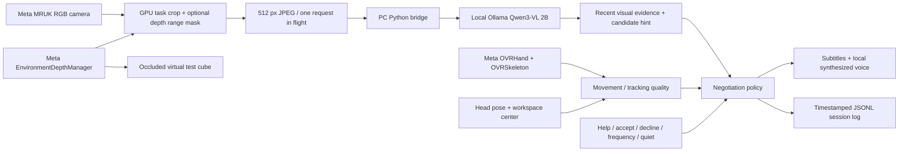

# Negotiable AR prototype

The architecture follows the supplied *Literature Review And Pilot Plan* conversation: separate perception, assistance content, intervention timing, user negotiation, and research logging. The activity is intentionally configured through a task profile rather than hard-coded as tangram solving.

## Perception

- RGB: `Meta.XR.PassthroughCameraAccess`, not a Unity webcam or a screenshot of the eye buffer. It requests the official headset camera permission through `OVRManager`. A single left camera supplies task imagery.
- Hands: `OVRHand` confidence/pinch state and all available `OVRSkeleton` bone positions at headset frame rate. Small markers show sampled joints. Positions are Unity world space, in meters. Pinches control the panel; they do not implicitly accept assistance.
- Activity: joint speed above 0.12 m/s is a heuristic for movement. It does not establish object contact, manipulation intent, or cognitive difficulty. Tracking loss/reacquisition resets the pause timer. At least one reliable hand and a head direction within 55 degrees of the workspace center are required for an automatic offer.
- Objects: the VLM returns up to four visually distinctive item labels with approximate normalized image boxes, a scene summary, an uncertain task phase, and one candidate hint. Results are intermittent observations; they do not establish persistent identity across occlusion or millimeter-accurate LEGO assembly state. Boxes are validated and remain relative to the **processed image**, origin top-left. Invalid boxes receive `boundsValid=false` while retaining the item label; invalid locations are never used as spatial evidence. They are not projected into the world.
- Foreground: a GPU pass crops the lower central 76% × 72% of the image before readback and JPEG encoding. When valid environment depth is available, RGB camera rays at a configurable 1.4 m range are reprojected into the left depth view. Comparing measured depth with that boundary suppresses more distant surfaces, with a 12 cm transition tolerance. The pose comes from the RGB image timestamp and is transformed from tracking to Unity world space. Interpolated pinhole directions account for asymmetric RGB intrinsics. Missing/invalid depth and uncovered pixels retain cropped RGB. This is an approximate range mask, not per-object segmentation; table geometry and room surfaces within the range can remain. The model is instructed to ignore structural room context unless the task includes it.
- Depth: `EnvironmentDepthManager` consumes Meta's environment depth through Unity OpenXR: Meta. The scene includes an occlusion-material cube for testing real hand/object occlusion. Depth affects the VLM image through foreground masking; raw depth maps are not transmitted. The panel remains readable and the user's passthrough is unchanged.
- Panel: a title-bar collider supports pointer dragging from either controller or a tracked hand. A held gesture owns one pointer source, ends on release/tracking loss, and requires release before a recovered/switching pointer can click. Dragging does not move the workspace reference or constitute agreement with an offer. There is no recenter button.

## What and when

The VLM proposes the content. A pure C# policy makes the timing and negotiation decision; it does not delegate consent to a language model.

1. Preserve active exploration and wait for fresh, sufficiently confident perception.
2. A possible pause after 12 seconds can produce a short **offer**, never an automatic task instruction.
3. Accept or Help delivers a recent candidate hint. Missing or stale evidence produces an intent clarification.
4. Decline or Later causes a temporary backoff. It does not establish a permanent preference.
5. An unanswered offer expires after 10 seconds, increases cooldown, and leaves intent unknown.
6. Quiet persists until Resume. A direct Help request works while quiet and preserves quiet mode afterward.
7. More/Less adjusts offer spacing. Cooldown starts at 25 seconds and is bounded at 120 seconds.

`AssistanceMode.OnRequest` is also available in the policy for later experimental comparisons. The current headset panel exposes negotiated and quiet operation. The default pause and confidence thresholds are engineering starting points, not literature-validated measurements of struggle. The W/T log labels are illustrative mappings from the referenced conversation, not a completed coding of the attached literature workbook.

## Latency and failure behavior

Camera sampling defaults to 1.5 seconds, 512 pixels wide, JPEG quality 65. A request must finish before another frame is captured; busy server requests receive HTTP 429 rather than joining an obsolete queue. The service's model deadline is 5 seconds; Unity's network deadline is 6 seconds, with an 8-second maximum observation age measured from **capture**, not response arrival. Model failures preserve silence; explicit Help can still ask a contextual question. The panel labels old observations as stale.

GPU readback is asynchronous where supported. JPEG encoding still occurs on Unity's main thread; profile it on Quest before increasing image size or sample rate. VLM confidence is self-reported and uncalibrated. The policy uses it only as a conservative input gate, not a probability of user difficulty.

The RTX 5080 local smoke test on a synthetic three-shape image produced approximately 1.1–1.3 second warmed inference and a valid local TTS WAV. Repeated identical-image requests benefit from caching; this is not a moving-camera latency or recognition benchmark. The first GPU/model load took approximately 23 seconds; warmup should precede a participant session.

## Provider boundary

Unity sends the same `/observe` request regardless of model provider. The Python service defaults to Ollama. `VLM_PROVIDER=compatible` uses an HTTP chat-completions-compatible endpoint with image input, selected by `VLM_URL`, `VLM_MODEL`, and optional `VLM_API_KEY`. That adapter is contract-tested with a mock response; no online provider has been connected or called. Online providers must support image inputs and JSON mode. Credentials stay on the PC.

Windows `System.Speech` provides the local voice adapter over `/speak`. Voice output is replaceable independently from perception; if synthesis fails, subtitles remain. This prototype does not include speech recognition, an always-listening microphone, or a learned user-intent model.

## Logs

Session JSONL files live at `Application.persistentDataPath/Sessions`. Each record includes UTC, a session ID, monotonic time, an event kind, and a payload. Events include explicit signals, decisions, withheld reasons, capture/inference timing, and voice failure. The default log excludes full observations and all camera pixels; `logObservations` opts into text observations. Agent utterances and task configuration are logged. Access tokens are excluded. No frames are saved by the service.

## Further work after choosing a task

Configure participant goals and meaningful task phases, add a task-specific success evaluator if needed, benchmark real pieces and occlusion, calibrate intervention thresholds, and evaluate the appropriateness of hints. Add persistent item tracking or depth-based anchoring only when the activity requires it. More elaborate negotiation can use deliberate user dialogue; inaction should remain ambiguous evidence.
